# Investigation: Impossible Travel and Unfamiliar Sign-In

**Platform:** Splunk · **Index:** `cloud` · **Date:** 2024-02-11 UTC · **Events:** 242
**Source:** Microsoft 365 unified audit log (`auditlogs.json`, sourcetype `_json`)
**Context:** the organisation is located in Vancouver, BC, Canada.

> The dataset was generated through third-party VPN exit nodes, so the
> geolocation is treated here as the user's real location. In production, a
> sign-in from a commercial VPN or hosting ASN is a finding in its own right.

---

## Findings

### 1. What account was compromised?

**`jchan@7pd6vr.onmicrosoft.com`**

### 2. According to OSINT, where did this user log in from?

**Singapore.** `188.214.125.138` — AS9009 M247 Europe SRL (company record:
M247 LTD Manila Infrastructure), per ipinfo.io.

The user's other logins came from `181.214.153.165`, Vancouver, BC (AS174 Cogent
Communications), matching the company's location.

### 3. What date and time did this login occur (UTC)?

**2024-02-11 20:46:39 UTC** — the first `UserLoggedIn` from the Singapore
address. The previous login from Vancouver was at 20:33:37 UTC, 13 minutes and
2 seconds earlier.

Later logins from the same address: 20:46:42, 20:46:46, 20:55:04, 21:06:12,
21:25:24.

### 4. What activities were done from this IP?

| Operation | Workload | What it means here |
|---|---|---|
| `UserLoggedIn` | AzureActiveDirectory | 11 sign-in events across six timestamps |
| `MailItemsAccessed` | Exchange | Four individual emails opened (`MailAccessType: Bind`) via OWA |
| `Set-Mailbox` | Exchange | `ForwardingSmtpAddress` set to `smtp:stoicellis@imcourageous[.]com` |
| `New-InboxRule` | Exchange | Rule `1`: from `schan` → forward externally, mark read, move to Deleted Items, stop processing rules |
| `Create` | Exchange | Draft items, including `URGENT: Client Bank Account` |
| `MoveToDeletedItems` | Exchange | `Re: First Invoice of the month!` moved from Drafts to Deleted Items |
| `Send` | Exchange | `URGENT: Client Bank Account` sent with `NEW-BANK-ACCOUNT.pdf` (43,059 bytes) |

### 5. Did any other account log in from this IP?

**No.** Every event tied to `188.214.125.138` has `UserId = jchan`. The only
other user in the login data, `schan`, authenticated from `181.214.153.176`
(Vancouver) only.

`schan` is still affected: they are the target of the inbox rule and the
recipient of the fraudulent email.

### 6. If you received this alert, what would your next steps be?

See [Response actions](#response-actions).

---

## Walkthrough

### Orientation

```spl
index="cloud" | table ClientIPAddress, Operation, UserId, Workload
```

242 events across two workloads, `Exchange` and `AzureActiveDirectory`. `table`
is used first on purpose: it prints a row for every event, including those where
a field is empty. `stats count by` drops any event missing one of the `by`
fields, which hides exactly the gap found in the next step.

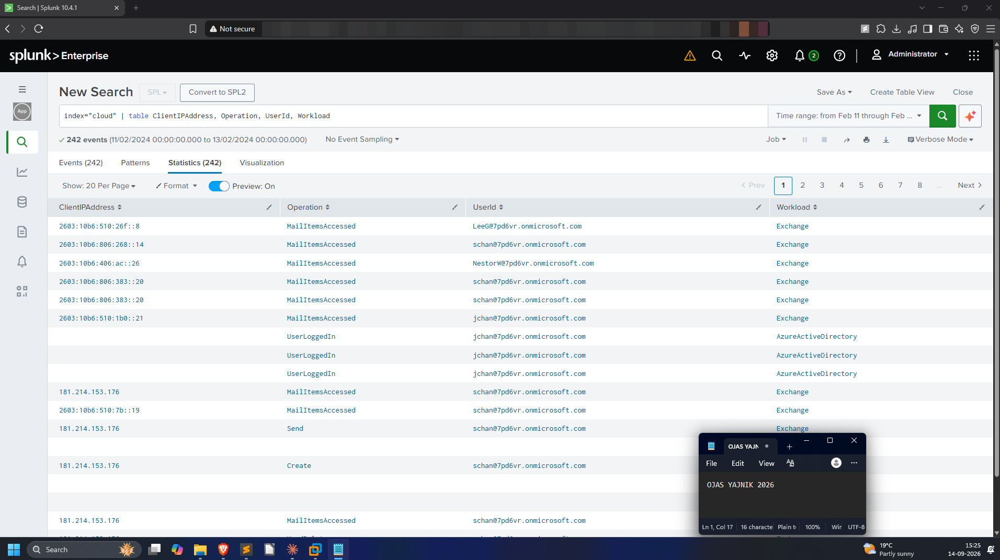

### Logins only

```spl
index="cloud" Operation=UserLoggedIn
| table ClientIPAddress, Operation, UserId, Workload
```

23 events, and `ClientIPAddress` is empty on all of them. The field exists on
Exchange records but not on Azure AD sign-in records.

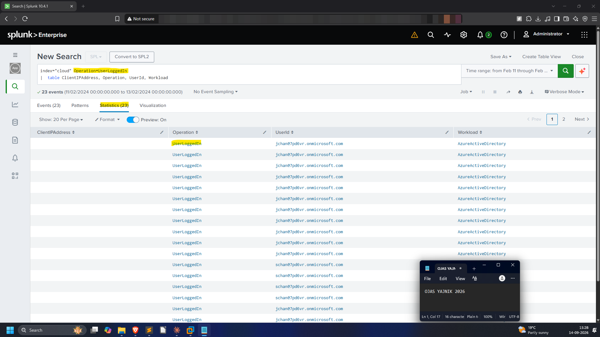

Opening a raw event shows the Azure AD equivalents: `ActorIpAddress` and
`ClientIP`.

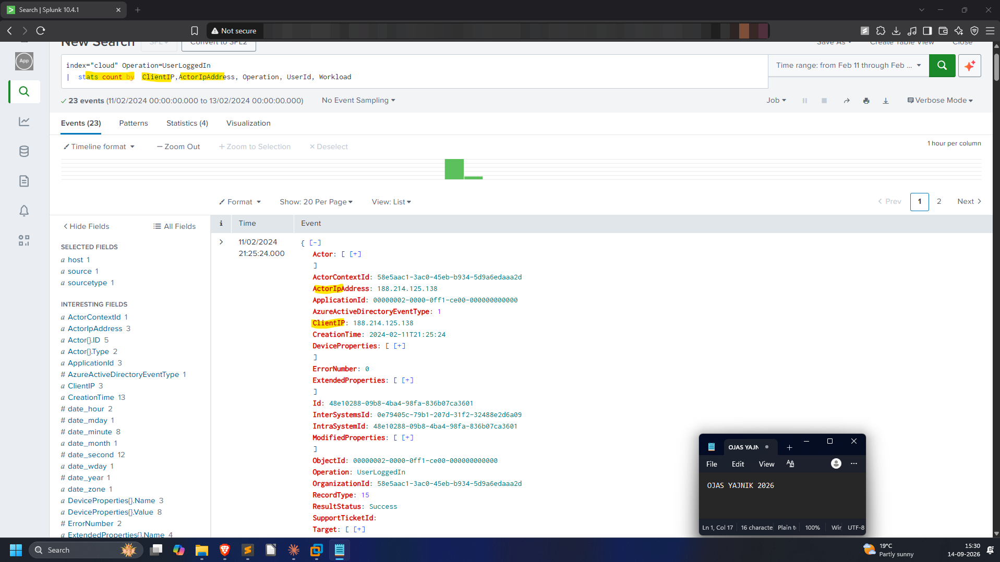

| Workload | IP field(s) |
|---|---|
| Exchange | `ClientIPAddress` (some records also carry `ClientIP`) |
| AzureActiveDirectory | `ClientIP`, `ActorIpAddress` |

### Removing system accounts

Grouping by the correct fields returns four rows, one of them a user shown as
"Not Available". `UserType` has two values in this data: `0` (19 events) and `4`
(4 events). `4` is a system account.

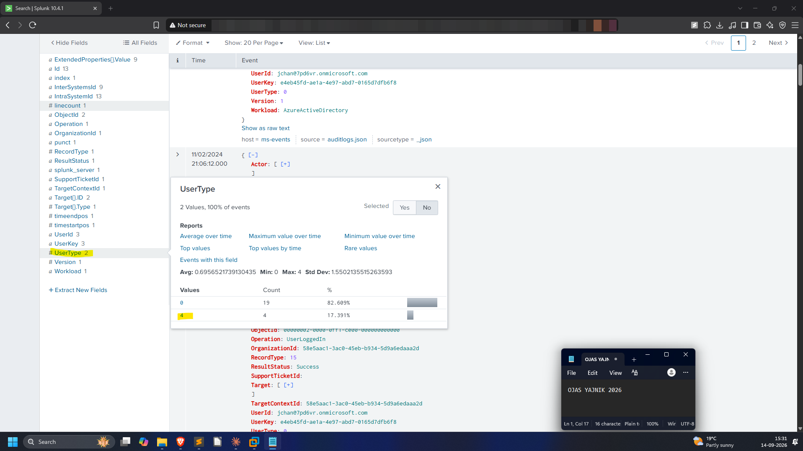

```spl
index="cloud" Operation=UserLoggedIn UserType!=4
| stats count by ClientIP, ActorIpAddress, Operation, UserId, Workload
```

| ClientIP | UserId | count |
|---|---|---|
| 181.214.153.165 | jchan | 4 |
| 181.214.153.176 | schan | 4 |
| 188.214.125.138 | jchan | 11 |

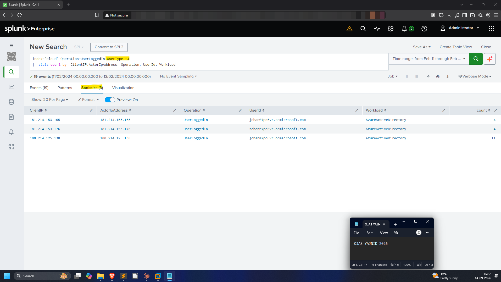

### OSINT

| IP | Location | ASN | Company |
|---|---|---|---|
| 181.214.153.165 | Vancouver, BC, CA | AS174 Cogent Communications | Internet Utilities Europe and Asia Limited |
| 181.214.153.176 | Vancouver, BC, CA | AS174 Cogent Communications | Internet Utilities Europe and Asia Limited |
| 188.214.125.138 | Singapore, SG | AS9009 M247 Europe SRL | M247 LTD Manila Infrastructure |

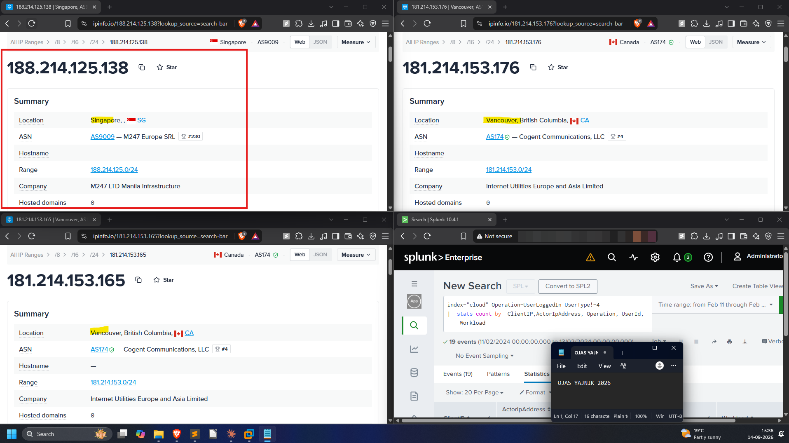

### Isolating the user and adding time

`schan` only ever appears from Vancouver, so that user is excluded and `_time` is
added.

```spl
index="cloud" Operation=UserLoggedIn UserType!=4 UserId!=schan@7pd6vr.onmicrosoft.com
| stats count by _time, ClientIP, ActorIpAddress, Operation, UserId, Workload
```

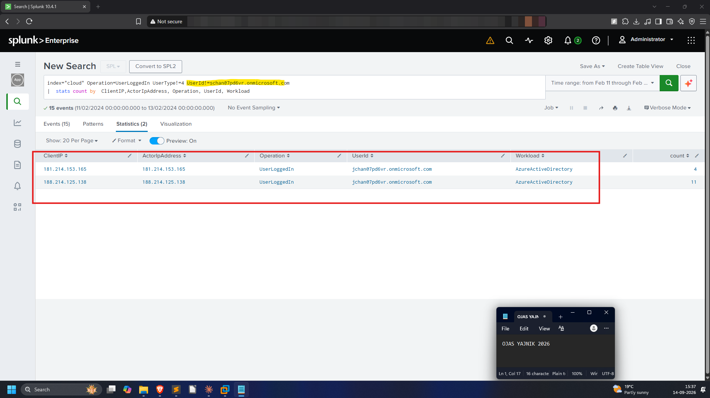
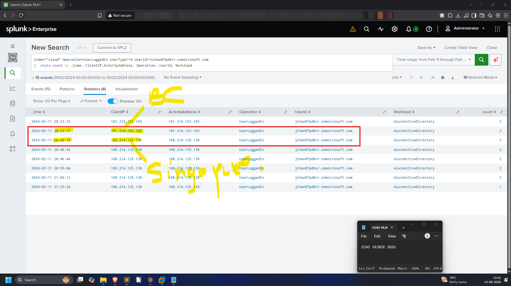

| _time (UTC) | ClientIP | Location |
|---|---|---|
| 2024-02-11 20:33:35 | 181.214.153.165 | Vancouver |
| 2024-02-11 20:33:37 | 181.214.153.165 | Vancouver |
| **2024-02-11 20:46:39** | **188.214.125.138** | **Singapore** |
| 2024-02-11 20:46:42 | 188.214.125.138 | Singapore |
| 2024-02-11 20:46:46 | 188.214.125.138 | Singapore |
| 2024-02-11 20:55:04 | 188.214.125.138 | Singapore |
| 2024-02-11 21:06:12 | 188.214.125.138 | Singapore |
| 2024-02-11 21:25:24 | 188.214.125.138 | Singapore |

**Impossible travel:** 13 minutes between Vancouver and Singapore, roughly
12,800 km apart; a commercial flight takes about 16 hours.

**Unfamiliar sign-in:** `jchan` has no earlier login from Singapore in the
available data. That data covers one day. A real determination needs 30 to 90
days of sign-in history for the user.

### Scoping the IP

```spl
index="cloud" 188.214.125.138
| stats count by _time, Operation, UserId, Workload
| sort +_time
```

96 events, 18 rows, one user.

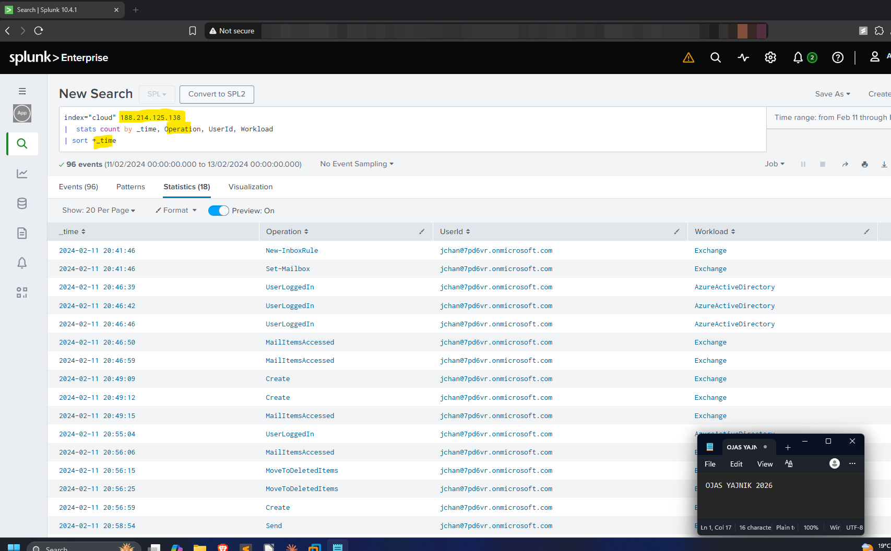

| _time (UTC) | Operation |
|---|---|
| 20:41:46 | New-InboxRule (see [timestamp discrepancy](#timestamp-discrepancy)) |
| 20:41:46 | Set-Mailbox (see [timestamp discrepancy](#timestamp-discrepancy)) |
| 20:46:39 | UserLoggedIn |
| 20:46:42 | UserLoggedIn |
| 20:46:46 | UserLoggedIn |
| 20:46:50 | MailItemsAccessed |
| 20:46:59 | MailItemsAccessed |
| 20:49:09 | Create |
| 20:49:12 | Create |
| 20:49:15 | MailItemsAccessed |
| 20:55:04 | UserLoggedIn |
| 20:56:06 | MailItemsAccessed |
| 20:56:15 | MoveToDeletedItems |
| 20:56:25 | MoveToDeletedItems |
| 20:56:59 | Create |
| 20:58:54 | Send |
| 21:06:12 | UserLoggedIn |
| 21:25:24 | UserLoggedIn |

### The inbox rule

```spl
index="cloud" 188.214.125.138 Operation=New-InboxRule
```

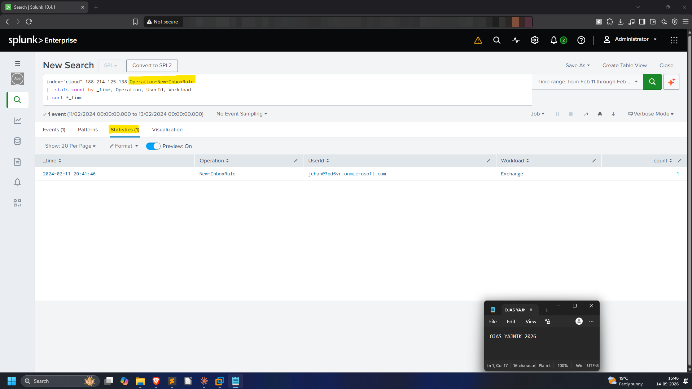
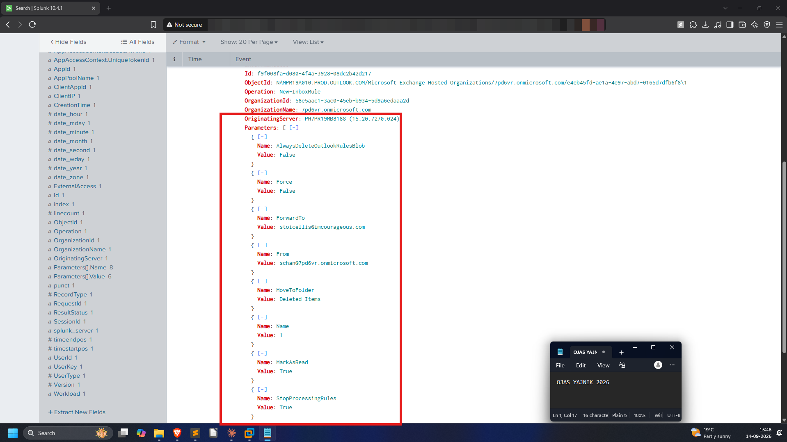

| Parameter | Value |
|---|---|
| Name | `1` |
| From | `schan@7pd6vr.onmicrosoft.com` |
| ForwardTo | `stoicellis@imcourageous[.]com` |
| MoveToFolder | Deleted Items |
| MarkAsRead | True |
| StopProcessingRules | True |
| AlwaysDeleteOutlookRulesBlob | False |
| Force | False |

The rule lives on `jchan`'s mailbox: the event's `ObjectId` ends in
`e4eb45fd-ae1a-4e97-abd7-0165d7dfb6f8\1`, which is `jchan`'s `UserKey` followed
by the rule name. Its effect is to intercept the conversation with `schan`.
Any reply `schan` sends goes to the attacker and is hidden from the mailbox owner.
A single-character rule name is a common tell.

### The forwarding address

Searching the domain rather than the full address, because the local part can
differ per victim:

```spl
index="cloud" @imcourageous.com
```

Two events: the `New-InboxRule` above, and a `Set-Mailbox` with
`ForwardingSmtpAddress = smtp:stoicellis@imcourageous[.]com`, made through OWA
(`AppPoolName: MSExchangeOWAAppPool`) from the Singapore address.

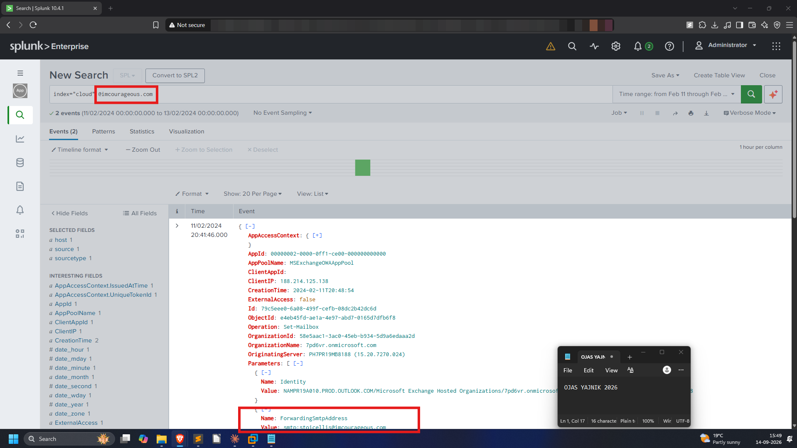

The two controls are different. The inbox rule targets one sender and hides the
result. `ForwardingSmtpAddress` forwards the entire mailbox. With one day of
data this search cannot show whether the domain touched any other mailbox
earlier; in production it should run over at least 30 days.

Hunt tip: searching the keyword `ForwardingSmtpAddress` across mail audit logs
and reviewing any external value is a quick way to find this technique
tenant-wide.

### Timestamp discrepancy

Splunk assigns both mailbox-configuration events `_time = 20:41:46`, almost five
minutes before the first Singapore `UserLoggedIn` at 20:46:39.

The `Set-Mailbox` event's own `CreationTime` field is `2024-02-11T20:48:54`.
That is after the login and after the first mail access (20:46:50), and it fits
the rest of the sequence.

Both events carry an `AppAccessContext` object with an `IssuedAtTime` field,
placed ahead of `CreationTime` in the JSON. The likely
explanation is that Splunk's timestamp extraction took the first timestamp in
the JSON (`IssuedAtTime`) instead of `CreationTime`. On the other events
checked, which do not start with that block (`UserLoggedIn`, `Send`, `Create`,
`MoveToDeletedItems`), `_time` and `CreationTime` match exactly.

What was verified and what was not:

- Verified: `Set-Mailbox` shows `_time` 20:41:46 and `CreationTime` 20:48:54.
- Not verified: the `AppAccessContext.IssuedAtTime` value itself (the block was
  collapsed in the capture), and the `New-InboxRule` event's `CreationTime`.

If `IssuedAtTime` does read 20:41:46, there is a second question worth asking:
a token issued five minutes before the first recorded Singapore sign-in may mean
the session was established some other way than the logins seen here.

Practical consequence: when building a timeline from M365 audit data in Splunk,
sort on `CreationTime`, or fix `TIME_PREFIX` / `TIMESTAMP_FIELDS` for the
sourcetype, rather than trusting `_time`.

### Which emails were accessed

```spl
index="cloud" 188.214.125.138 Operation=MailItemsAccessed
| stats count by _time, Operation, UserId, Workload
| sort +_time
```

Six events at four timestamps: 20:46:50, 20:46:59, 20:49:15, 20:56:06.

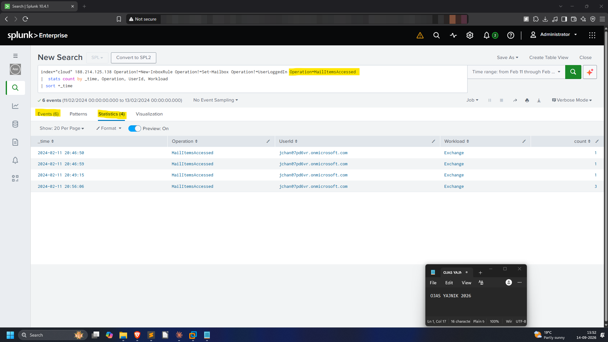

Inside the event: `ClientInfoString: Client=OWA;Action=ViaProxy` (the user-agent
equivalent, showing Outlook on the web), folder path `\Drafts`, and
`MailAccessType: Bind`.

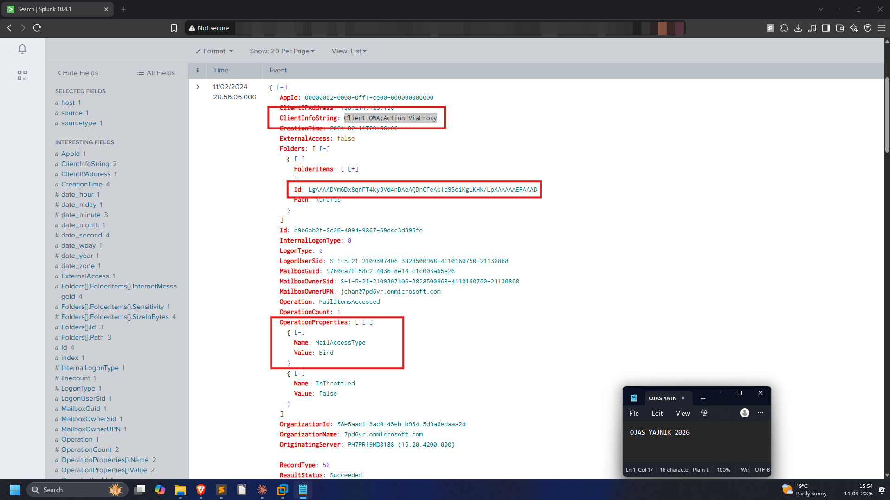

| MailAccessType | Meaning |
|---|---|
| `Sync` | A client downloaded a large set of items to a local machine. The individual messages are not listed. |
| `Bind` | An individual message was accessed. Its `InternetMessageId` is recorded. |

`Bind` means the exposure can be stated per message. The ID is in a nested field,
so the short name returns nothing and the full path is needed:

```spl
index="cloud" 188.214.125.138 Operation=MailItemsAccessed
| stats count by Folders{}.FolderItems{}.InternetMessageId
```

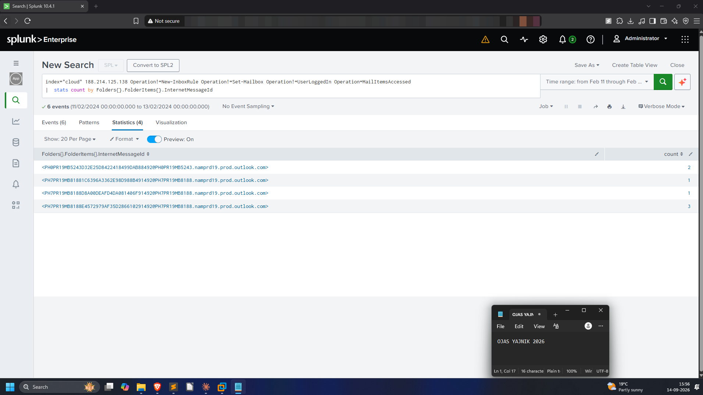

Four message IDs:

```
PH0PR19MB5243D32E25D8422418499DAB88492@PH0PR19MB5243.namprd19.prod.outlook.com
PH7PR19MB81881C6396A3362E98D988B491492@PH7PR19MB8188.namprd19.prod.outlook.com
PH7PR19MB8188D8A00DEAFD4DA081406F91492@PH7PR19MB8188.namprd19.prod.outlook.com
PH7PR19MB8188E4572979AF35D286610291492@PH7PR19MB8188.namprd19.prod.outlook.com
```

To correlate one, strip the angle brackets and everything from the `@` onward,
then search the remainder as a keyword:

```spl
index="cloud" 188.214.125.138 PH7PR19MB8188D8A00DEAFD4DA081406F91492
| stats count by _time, Operation, UserId, Workload
```

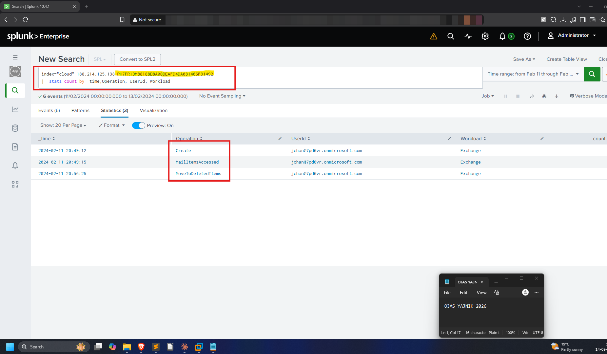

| _time (UTC) | Operation |
|---|---|
| 20:49:12 | Create |
| 20:49:15 | MailItemsAccessed |
| 20:56:25 | MoveToDeletedItems |

The `Create` event gives the subject: `Re: First Invoice of the month!`.

### Create

```spl
index="cloud" 188.214.125.138 Operation=Create
```

Four events, two subjects: `URGENT: Client Bank Account` and
`Re: First Invoice of the month!`. Both in `\Drafts`.

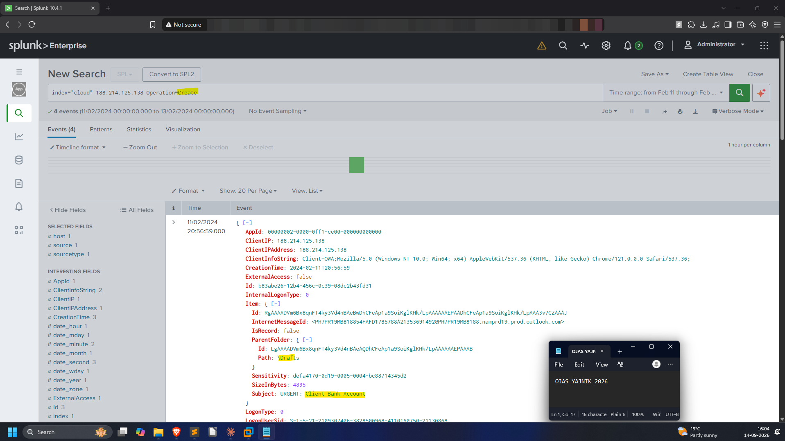

The 20:56:59 event carries a full browser user agent: Chrome 121 on Windows 10
x64, through OWA.

`Create` means an item was created in Drafts, Calendar, Contacts, Notes or Tasks.
It does not prove the attacker wrote the message from scratch. It does mean the
attacker had the content of both threads in front of them.

### MoveToDeletedItems

```spl
index="cloud" 188.214.125.138 Operation=MoveToDeletedItems "AffectedItems{}.Subject"="Re: First Invoice of the month!"
```

`Folder.Path = \Drafts`, `DestFolder.Path = \Deleted Items`, at 20:56:25. The
attacker removed the draft reply on the invoice thread.

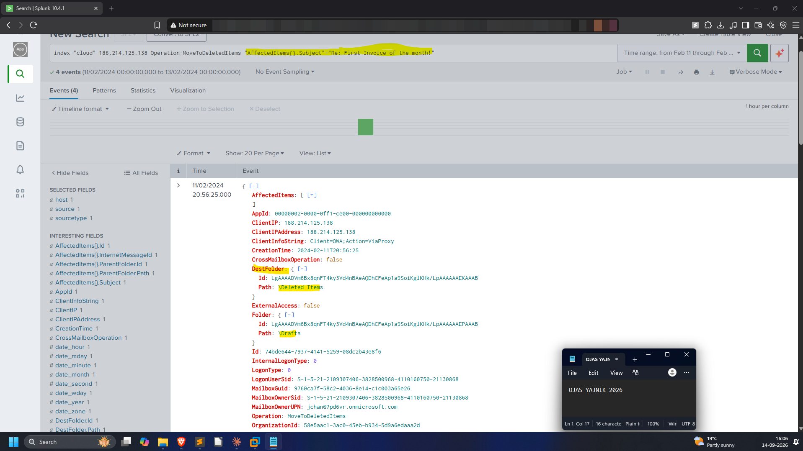

### Send

```spl
index="cloud" 188.214.125.138 Operation=Send
```

One event, 20:58:54 UTC.

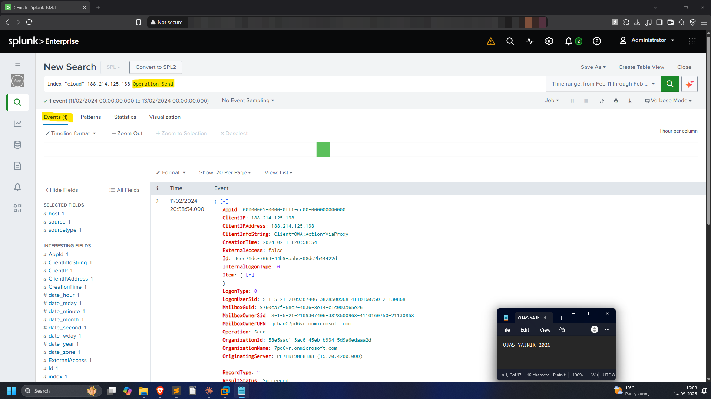
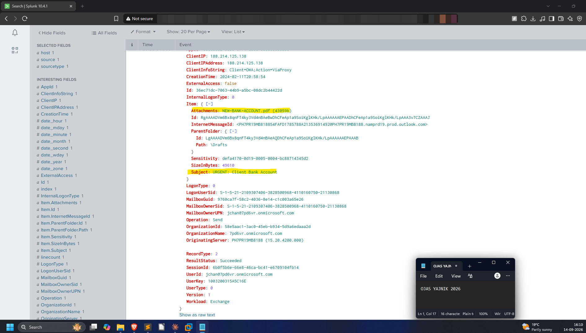

| Field | Value |
|---|---|
| Subject | `URGENT: Client Bank Account` |
| Attachment | `NEW-BANK-ACCOUNT.pdf` (43059b) |
| SizeInBytes | 49610 |
| ClientInfoString | `Client=OWA;Action=ViaProxy` |
| InternetMessageId | `PH7PR19MB818854FAFD1785788A21353691492@PH7PR19MB8188.namprd19.prod.outlook.com` |
| SessionId | `6b0f5b6e-66e8-46ca-bc41-e6709104fb14` |

### Who received it

```spl
index="cloud" "URGENT: Client Bank Account"
```

Nine events, two users: `schan` (6) and `jchan` (3).

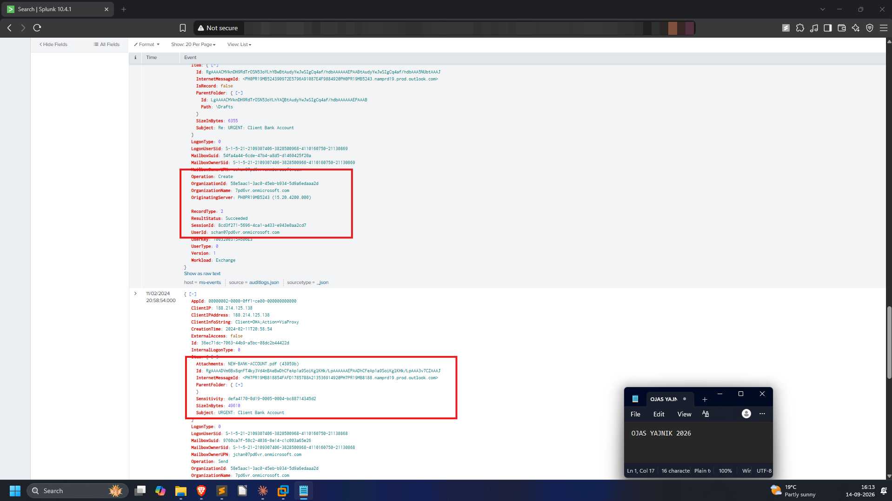
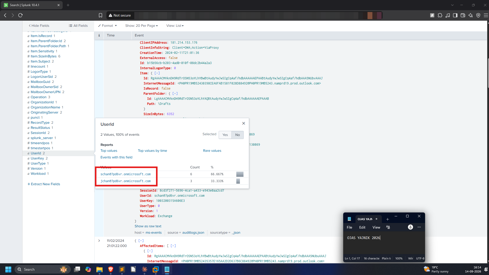

`schan` has a `Create` event for `Re: URGENT: Client Bank Account` in `\Drafts`
at 21:01:36 UTC from `181.214.153.176`, the Vancouver office address. `schan`
received the email and started a reply within three minutes. Whether that reply
was sent, and what it said, is not established by the events captured here and
is the first thing to confirm with the user.

---

## Response actions

**Contain (immediately)**

- Revoke all sessions and refresh tokens for `jchan`; reset the password;
  review and re-register MFA methods.
- Remove inbox rule `1` and clear `ForwardingSmtpAddress` on `jchan`'s mailbox.
- Contact `schan` directly, by phone or in person and not by email: do not act on
  the bank account change, and confirm whether a reply was sent or any payment
  detail was altered.
- Alert finance. Put a hold on any change to payee bank details tied to this
  client until verified through a known-good channel.
- Purge `URGENT: Client Bank Account` from every mailbox it reached.

**Scope**

- Search 30 to 90 days for `188.214.125[.]138`, the `188.214.125.0/24` range,
  and `imcourageous[.]com` across sign-in, Exchange and mail-flow logs.
- Tenant-wide search for `New-InboxRule`, `Set-InboxRule` and
  `ForwardingSmtpAddress` with external targets.
- Retrieve the four accessed messages by `InternetMessageId` to state exactly
  what was exposed.
- Check `jchan` for new MFA methods, OAuth application consents and mailbox
  delegation added in the window.
- Check mail-flow logs for anything already forwarded to the external address.
- Identify initial access: review `jchan`'s inbound mail for phishing, and the
  sign-in details (MFA result, user agent, device) for the first Singapore login.
- Resolve the [timestamp discrepancy](#timestamp-discrepancy).

**Eradicate and recover**

- Block the sender domain and address at the mail gateway.
- Retrieve and analyse `NEW-BANK-ACCOUNT.pdf` in a sandbox.
- Restore any legitimate messages moved to Deleted Items.

**Prevent**

- Disable automatic external forwarding tenant-wide (outbound spam policy).
- Conditional Access: require compliant devices or phishing-resistant MFA;
  evaluate sign-in risk; block or challenge sign-ins from anonymiser and hosting
  networks if third-party VPNs are not authorised.
- Alert on inbox rules that combine external forwarding with delete or
  mark-as-read actions.
- Out-of-band verification for any change to payment details.

**Report**

- Timeline, scope, exposed messages and business impact to the client or
  management. If a payment was redirected, escalate to the bank and follow the
  organisation's fraud and breach-notification process.
